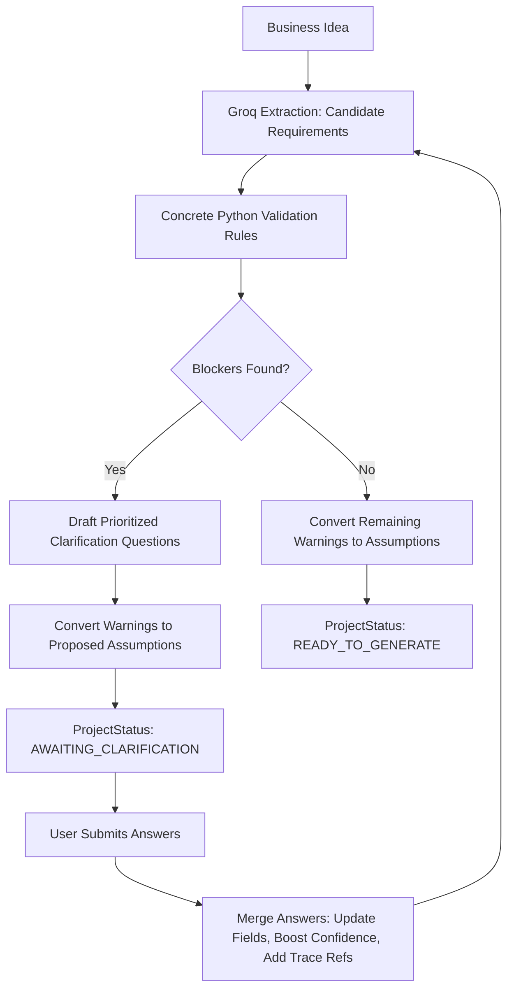

# BRD Agent — Backend Core Foundation, AI Core Loop & FastAPI HTTP Persistence

Core domain foundation, AI Core Loop, and RESTful API persistence layer for **BRD Agent** — an AI system that transforms raw business ideas and source documents into structured Business Requirements Documents (BRDs), actively detecting gaps and asking targeted clarification questions.

---

## Status: Durable Persistence, FastAPI Endpoints & Groq LLM Integration

> [!NOTE]
> The backend uses **Groq** (`llama-3.3-70b-versatile` by default) as its OpenAI-compatible LLM provider for fast, reliable structured JSON extraction:
> - Free API keys can be generated at [console.groq.com/keys](https://console.groq.com/keys).
> - **Durable persistence** via Supabase Postgres with complete state machine lifecycle enforcement.
> - Projects, candidate requirements, clarification questions, user answers, assumptions, validation issues, and audit-trail state transitions survive server restarts.
> - HTTP endpoints for project creation, detail with entity counts, analysis execution, question querying, answer submissions, assumption decisions, and generation guardrails.
> - Full test suite passing with in-memory persistence and mocked LLM calls without requiring live credentials.

---

## Architecture Overview

```
backend/
├── app/
│   ├── __init__.py
│   ├── config.py                  # GROQ_API_KEY, GROQ_MODEL, Supabase settings & validation
│   ├── models/                    # Pydantic v2 domain models
│   │   ├── __init__.py
│   │   ├── project.py             # Project & ProjectStatus enum
│   │   ├── requirement.py         # Requirement, RequirementType, Priority (MoSCoW)
│   │   ├── question.py            # Clarification Question, AnswerFormat, compute_priority()
│   │   ├── answer.py              # Answer submitted by user
│   │   ├── assumption.py          # Explicit assumptions, ImpactLevel, AssumptionStatus
│   │   ├── validation.py          # ValidationResult, ValidationIssue, Severity
│   │   └── document.py            # SourceDocument, SourceChunk, BRDDocumentVersion
│   ├── llm/                       # LLM integration (Groq client wrapper)
│   │   ├── __init__.py
│   │   ├── gemini_client.py       # GeminiClient (powered by Groq chat completions + JSON mode)
│   │   ├── prompts.py             # Pure string template prompt builders
│   │   └── schemas.py             # Pydantic schemas for structured LLM decoding
│   ├── core/                      # Core business logic & state transitions
│   │   ├── __init__.py
│   │   ├── state_machine.py       # Deterministic ProjectStateMachine rule engine
│   │   ├── extraction.py          # Requirement extraction & ID preservation
│   │   ├── validation_rules.py    # Concrete Python completeness rules (zero LLM calls)
│   │   ├── question_engine.py     # Blocker-to-question & warning-to-assumption engine
│   │   ├── merge.py               # Immutable answer merging with traceability refs
│   │   └── orchestrator.py        # BRDOrchestrator: extract -> validate -> ask -> merge -> recheck
│   ├── db/                        # Supabase persistence layer
│   │   ├── __init__.py
│   │   ├── supabase_client.py     # Supabase client singleton factory
│   │   └── repository.py          # ProjectRepository CRUD, audit trails & state transitions
│   ├── api/                       # FastAPI REST routes and dependencies
│   │   ├── __init__.py
│   │   ├── deps.py                # Dependency injection for Repository and LLM client
│   │   ├── schemas_api.py         # HTTP request/response schemas
│   │   └── routes_projects.py     # /projects REST endpoints
│   └── templates/                 # BRD structure templates
│       ├── __init__.py
│       └── brd_template.py        # build_brd_skeleton() function
├── scripts/
│   └── run_cli_demo.py            # Interactive CLI loop testing extraction & clarification
├── tests/                         # Pytest test suite (42 unit & integration tests)
├── run_lifecycle_demo.py          # State machine lifecycle demonstration script
├── pytest.ini
├── requirements.txt
└── .env.example
```

---

## AI Core Loop Workflow



---

## Deterministic Validation Rules (`core/validation_rules.py`)

Per architectural specifications, **the backend rule engine, not the LLM, decides completeness**:

| Requirement Type | Rule Condition | Severity | Code |
| :--- | :--- | :--- | :--- |
| **Functional** | Missing actor / persona | BLOCKER | `FUNC_MISSING_ACTOR` |
| **Functional** | Missing expected outcome | BLOCKER | `FUNC_MISSING_OUTCOME` |
| **Functional** | Empty acceptance criteria | BLOCKER | `FUNC_EMPTY_ACCEPTANCE_CRITERIA` |
| **Nonfunctional** | Quality attribute unclear | BLOCKER | `NFR_UNCLEAR_ATTRIBUTE` |
| **Nonfunctional** | Attribute named but no metric target | WARNING | `NFR_NO_MEASURABLE_TARGET` |
| **Business** | Missing business objective | BLOCKER | `BIZ_MISSING_OBJECTIVE` |
| **Business** | Objective present but no success measure | WARNING | `BIZ_NO_SUCCESS_MEASURE` |
| **Constraint** | Missing rationale or external source | BLOCKER | `CONSTRAINT_MISSING_RATIONALE` |
| **Any** | Duplicate requirement (similarity > 0.85) | WARNING | `DUPLICATE_REQUIREMENT` |
| **Any** | Low extraction confidence (< 0.50) | WARNING | `LOW_CONFIDENCE_REQUIREMENT` |
| **Project-Level** | Zero business requirements | BLOCKER | `PROJECT_NO_BUSINESS_REQUIREMENTS` |
| **Project-Level** | Zero functional requirements | BLOCKER | `PROJECT_NO_FUNCTIONAL_REQUIREMENTS` |

---

## Setup & Running the FastAPI Server

Follow these steps to configure database persistence and run the backend server:

### 1. Create Supabase Project
1. Go to [supabase.com](https://supabase.com) and create a new project.
2. In your Supabase Dashboard, navigate to the **SQL Editor**.
3. Copy the full content of `backend/supabase/schema.sql` and paste it into the SQL editor.
4. Click **Run** to create all required tables (`projects`, `requirements`, `questions`, `answers`, `assumptions`, `validation_issues`, `state_transitions`, and placeholder tables for documents and versions), indexes, and security policies.

### 2. Configure Environment Variables
Copy `.env.example` to `.env` inside the `backend/` folder:
```bash
cp .env.example .env
```
Populate your credentials in `backend/.env` (get a free Groq API key at [console.groq.com/keys](https://console.groq.com/keys)):
```ini
GROQ_API_KEY=your_groq_api_key_here
GROQ_MODEL=llama-3.3-70b-versatile
SUPABASE_URL=https://your-project-id.supabase.co
SUPABASE_SERVICE_KEY=your-supabase-service-role-key-here
```

### 3. Install Dependencies
```bash
python -m pip install -r requirements.txt
```

### 4. Run the Pytest Test Suite
Run all unit and persistence integration tests (tests use dependency injection with in-memory stores and mock LLM responses, so no live credentials are required):
```bash
python -m pytest -v
```

All **42 tests** pass cleanly:
- Groq JSON structured extraction, code-fence stripping, schema error recovery, and API exponential backoff
- Full project lifecycle walkthrough and state machine validation
- Completeness rule verification (functional, NFR, business, constraint, project-level)
- Clarification question ranking and warning-to-assumption conversion
- Immutable answer merging and confidence restoration
- FastAPI REST endpoints: create, detail, list, analyze, questions, answers, assumptions, generation guard, and retry
- Transition audit trail logging in `state_transitions`

### 5. Start the FastAPI Development Server
From the `backend/` directory, launch the Uvicorn server:
```bash
uvicorn app.main:app --reload --port 8000
```

### 6. Interactive API Documentation
Open your browser and navigate to:
- Swagger UI: [http://localhost:8000/docs](http://localhost:8000/docs)
- ReDoc: [http://localhost:8000/redoc](http://localhost:8000/redoc)
- Health check: [http://localhost:8000/health](http://localhost:8000/health)

---

## FastAPI HTTP Endpoints (`/projects`)

| Method | Endpoint | Description | Expected Statuses / Enforcement |
| :--- | :--- | :--- | :--- |
| `POST` | `/projects` | Create a new project in `DRAFT` status with `input_revision=1` | Returns `Project` |
| `GET` | `/projects` | List recent projects (ordered by `created_at DESC`, limit 20) | Returns list of `Project` |
| `GET` | `/projects/{project_id}` | Fetch project details along with entity counts | Returns `ProjectDetailResponse` |
| `POST` | `/projects/{project_id}/sources` | Upload and process source document (PDF, DOCX, TXT), parse chunks | Enforces <= 10MB, saves document & chunks, returns `SourceDocumentResponse` |
| `GET` | `/projects/{project_id}/sources` | List uploaded source documents with chunk counts | Returns `SourceDocumentListResponse` |
| `POST` | `/projects/{project_id}/analyze` | Trigger Groq extraction + deterministic validation (using idea and/or source chunks) | Transitions `DRAFT` $\to$ `ANALYZING` $\to$ `AWAITING_CLARIFICATION` / `READY_TO_GENERATE` |
| `GET` | `/projects/{project_id}/questions` | Get active clarification questions ordered by priority desc | Only open questions |
| `POST` | `/projects/{project_id}/answers` | Submit answers to clarification questions | Enforces `AWAITING_CLARIFICATION`, bumps `input_revision`, re-analyzes |
| `GET` | `/projects/{project_id}/assumptions` | Get all project assumptions | Returns list of `Assumption` |
| `POST` | `/projects/{project_id}/assumptions/{assumption_id}/decision` | Accept or reject an assumption | If rejected, creates open question and moves `READY_TO_GENERATE` back to `AWAITING_CLARIFICATION` |
| `POST` | `/projects/{project_id}/generate` | Guardrail check for BRD document generation | Rejects if not `READY_TO_GENERATE` (HTTP 400); returns HTTP 501 until Step 5 |
| `POST` | `/projects/{project_id}/retry` | Recover from `FAILED` state back to `previous_valid_status` | Enforces `FAILED` status, clears `last_error` |

---

## Running the Interactive CLI Demo

To interactively test the complete loop in your terminal with live Groq credentials:

```bash
# Ensure GROQ_API_KEY is set in backend/.env
python scripts/run_cli_demo.py
```

